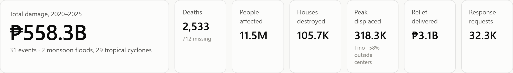
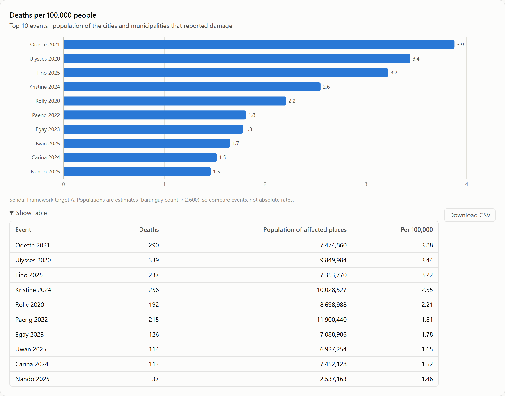
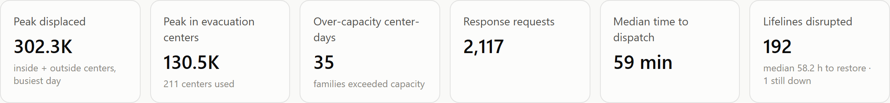
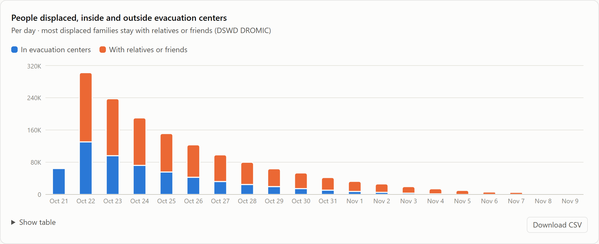
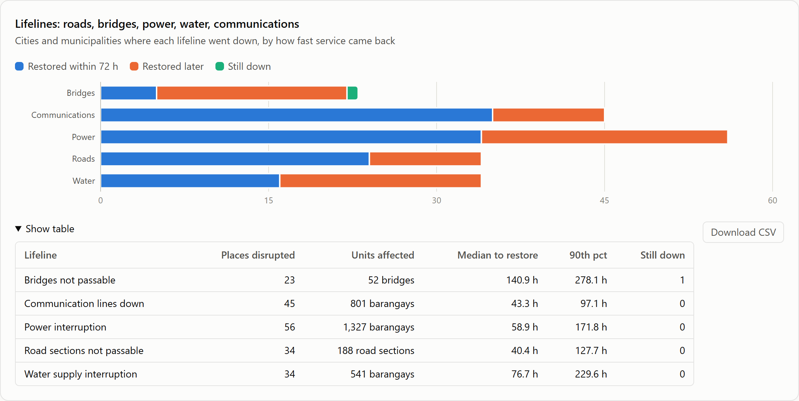
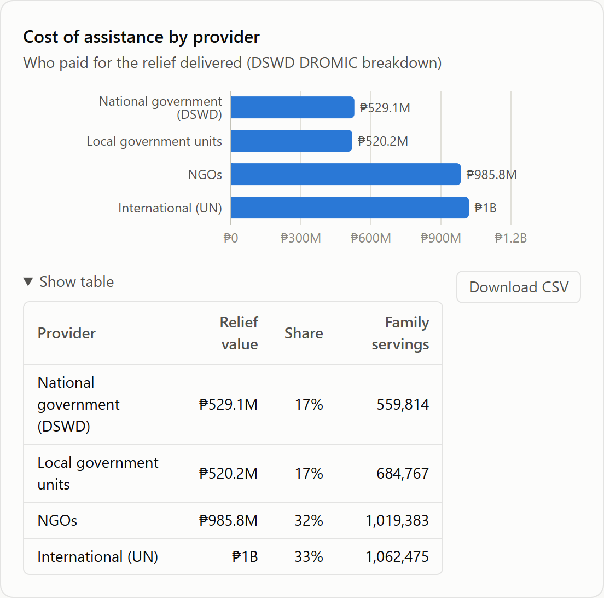

# Analytics: OLAP and Dashboards

## 1. OLAP approach (ROLAP)

DRIW implements OLAP relationally (ROLAP) in PostgreSQL rather than with a separate MOLAP cube
engine. The star schema is the cube: facts hold the measures, dimensions hold the hierarchies,
and SQL's OLAP operators produce the cube's cells.

| OLAP operation | How it is done | Example |
|---|---|---|
| Roll-up | `GROUP BY ROLLUP`, or grouping at a higher hierarchy level | Q02: damage by year with yearly subtotals |
| Drill-down | Group by a lower level of a hierarchy (region → province → city/municipality) | Q03 |
| Slice | Fix one dimension value (`WHERE`) | Q07 over-capacity centers; Q09 life-saving requests |
| Dice | Filter on several dimensions at once | Q11 organization × resource category |
| Pivot | Turn dimension values into columns (`FILTER`) | Q04 cyclone vs flood per region |
| Cube | Every combination of dimensions with subtotals (`GROUP BY CUBE`) | Q05; `mart.mart_impact_cube` |
| Grouping sets | Chosen roll-ups in one pass | `mart.mart_response_performance` |

**Pre-aggregation.** Eight materialized views in the `mart` schema hold the aggregates the
dashboards need. They refresh on every build and are tested to add back up to the facts. Reading a
mart is about 78× faster than aggregating the facts (see [query-performance.md](query-performance.md)).

The full set of sample analytical queries, each tied to a business question, follows this chapter
and is in [`sample-queries.sql`](sample-queries.sql).

## 2. Dashboards and web application walkthrough

The web application is the warehouse's presentation layer. It is built with Next.js and served by
Apache (XAMPP) at `http://localhost/driw/`. A PHP API (`/driw/api/`) reads the marts live from
PostgreSQL as the read-only role `driw_web`; if the warehouse is unreachable, the pages fall back
to a bundled snapshot of the same marts. This section shows every page and explains what each
part of it means. All figures shown are synthetic (see the notice on every page).

### Elements common to every page

| Element | What it means |
|---|---|
| Navigation bar | Executive, Operations and Logistics (one per audience), Data exchange (templates, checked uploads and Excel export for LGUs and agencies, see Chapter 10) and About. |
| Yellow notice | States which data is real (event names, dates, PSGC geography) and which is synthetic (all operational figures), so no figure is mistaken for an official statistic. |
| Event selector | On Operations and Logistics. The choice is kept in the address (for example `?event=TC2024-KRISTINE`), so a view can be bookmarked, shared or reloaded. Selecting an event is an OLAP *slice*. |
| Show table | Every chart has a table with the exact numbers: the accessible, color-free way to read it. |
| Download CSV | Exports the rows behind the chart with raw, unformatted values; the file opens directly in Excel. |
| Footer | Says where the numbers came from: "Live from the PostgreSQL warehouse … as read-only role driw_web", or that the bundled snapshot is being shown. |

### Executive overview

**Audience and purpose.** Leadership (NDRRMC council, regional directors) needs the six-year picture
on one screen: how bad it was, when, where, and how hard it hit relative to the population.
Answers BQ1, BQ2, BQ4 and BQ11. Data comes from `mart_event_summary` (one row per event) and
`mart_impact_cube` (the `GROUP BY CUBE` mart).

| Part of the screen | What it shows and how to read it |
|---|---|
| Hero figure | **₱558.3B** total damage across **31 events** (29 tropical cyclones, 2 monsoon floods), the sum of the latest valid situation report per place and category. |
| Headline tiles | Deaths (2,533, with 712 missing), people affected (11.5M), houses destroyed (105.7K), relief delivered (₱3.1B) and response requests (32.3K) are sums over events. *Peak displaced* (318.3K, Tino 2025) is different: displacement is semi-additive, so it is the highest single-day total of people inside evacuation centers **plus** people staying with relatives or friends, not a sum of days. Its note says 58% of them were outside centers. |
| Damage cost by year | Stacked columns by damage category. 2020 was the costliest year (₱142.6B, four events) and 2023 the lightest (₱32.2B). Agriculture is the largest category every year (₱83.9B of 2020's total), then infrastructure; housing is the smallest. |
| Costliest events | The ten events ranked by damage: Kristine 2024 (₱54.1B), Rolly 2020 (₱53.4B) and Ulysses 2020 (₱53.1B) lead. Three of the top five struck in 2020. |
| People affected by region | Region subtotals read straight from the CUBE mart: Bicol Region (2.64M people, ₱145.4B), then Cagayan Valley (2.00M) and Eastern Visayas (1.50M). |
| Deaths per 100,000 people | The ten events with the highest death rate relative to the population of the places that reported damage (close-up below). |
| All events table | One row per event, now with a *Deaths /100k* column; its CSV carries 38 columns per event, including the rates, displacement, relief by provider and lifeline figures. |

**What it means for decisions.** Damage is concentrated in a few strong typhoons and in a few
regions, Bicol above all. Agriculture absorbs the largest share of losses, so preparedness spending
on crop protection and post-disaster agricultural recovery gives the most return.

#### Close-up: headline tiles

The tile row is the first thing leadership reads. The hero figure (₱558.3B) is the six-year cost;
the tiles beside it count people, not pesos. The *Peak displaced* tile is the one to read
carefully: **318.3K** people were displaced on Typhoon Tino's worst day in November 2025, but only
132.5K of them were in evacuation centers. The other 185.8K (58%) stayed with relatives or friends.
A dashboard that counted only evacuation centers would have shown less than half of the people who
needed food packs, water and transport home.

#### Close-up: deaths per 100,000 people

Raw death counts favour storms that crossed many densely populated places. This chart divides
deaths by the population of the cities and municipalities that reported damage, the measure the
**Sendai Framework for Disaster Risk Reduction** uses for its target A (mortality per 100,000).
The table under the chart shows the three inputs: deaths, population of the affected places, and
the rate.

- **Odette 2021** has the highest rate (**3.88** deaths per 100,000) although Ulysses 2020 had more
  deaths (339 against 290): Odette killed a larger share of the people in its path.
- **Kristine 2024**, the costliest event (₱54.1B), is only fourth by death rate (2.55). Cost and
  mortality rank storms differently, so both views are needed.
- **Nando 2025** enters the top ten with just 37 deaths, because it struck a small population
  (2.5 million).
- Across the six years, 2,533 deaths equal **2.13 per 100,000** of the national population.

The population figures are estimates (barangay count × 2,600; see the note on the chart), so the
rates are for comparing events with each other, not official statistics. With the PSA census file
loaded, the same chart shows official rates without any code change.

### Operations (one event)

**Audience and purpose.** Regional operations managers and incident commanders. For one event,
it shows how many people were displaced (inside and outside evacuation centers), where centers were
overcrowded, which roads, bridges, power, water and communication lines went down and how fast they
came back, and how fast teams were dispatched. Answers BQ5, BQ6, BQ7 and BQ12. Shown here for Kristine
(October 2024); data comes from `mart_event_summary`, `mart_displacement_daily`,
`mart_evacuation_daily`, `mart_lifeline_restoration` and `mart_response_performance`.

| Part of the screen | What it shows and how to read it |
|---|---|
| Headline tiles | Peak displaced **302.3K** (inside plus outside centers) on the busiest day; peak in evacuation centers **130.5K** in **211** centers; **35** center-days over capacity; **2,117** response requests; median **59 minutes** from request to dispatch; **192** lifeline disruptions, restored in a median **58.2 hours**, one still down. |
| People displaced, inside and outside evacuation centers | Stacked columns per day: evacuation centers (blue) and families staying with relatives or friends (orange). See the close-up below. |
| People in evacuation centers | Total evacuees across all open centers, per day. It rises from 64,326 on 21 October (pre-emptive evacuation) to the peak of 130,515 on landfall day (22 October), then decays over about two weeks as families go home. |
| Centers over capacity | Number of centers whose families exceeded capacity, per day: 33 centers on landfall day, 2 the day after, then none. Overcrowding is a one-to-two-day problem. |
| Lifelines | For each lifeline, the cities and municipalities where it went down, split by how fast service came back. See the close-up below. |
| Median time to dispatch | Grouped columns by response type and priority (P1 critical, P2 urgent, P3 routine). Life-saving work goes fastest: search-and-rescue P1 in 0.26 h (about 16 minutes), medical evacuation P1 in 0.33 h. Relief delivery and road clearing wait longest, especially when routine: 12.4 h and 7.9 h at P3. |

**What it means for decisions.** Overflow centers must be ready *before* landfall, because nearly all
overcrowding happens on that one day. Priority triage works for life-saving requests; the slow
lanes are logistics (relief delivery, road clearing), where pre-positioned stock and equipment would
cut waiting most.

#### Close-up: operations tiles

Six numbers summarise the operation. The first two together show the size of the displacement:
302.3K people at the peak, of whom 130.5K were in centers. The last tile, *Lifelines disrupted*,
tells the incident commander how much of the area lost basic services (192 city-and-lifeline
combinations) and how long recovery took (median 58.2 hours, one bridge still impassable at the
last report).

#### Close-up: people displaced inside and outside evacuation centers

DSWD's DROMIC reports count displaced families in two places: inside evacuation centers, and
outside them, staying with relatives or friends. The chart stacks both for every day of Kristine:

- **21 October** (the day before the event began) shows only blue: **64,326** people moved into centers as a
  pre-emptive evacuation.
- **22 October** (the first day of the event) is the peak: **302,348** displaced, **130,515** in centers and
  **171,833** (57%) outside.
- Afterwards the centers empty faster than homes of relatives: by 24 October 62% of the displaced
  were outside centers. The last evacuees left the centers on **4 November**, but families were
  still staying with relatives until **9 November**.

The difference matters for relief: families outside centers are harder to find and register, yet
they are the majority. Across all 31 events, 61% of the people displaced on each event's peak day
were outside centers. *Show table* gives the daily numbers and the share outside.

#### Close-up: lifelines (critical infrastructure and basic services)

NDRRMC situation reports track the "lifelines" a community needs to function: roads and bridges
(transport) and power, water and communications (utilities). Each bar is one lifeline; its length
is the number of cities and municipalities where it went down, split into restored within 72 hours
(blue), restored later (orange) and still down at the last report (green).

| Lifeline (Kristine) | Places disrupted | Median to restore | Reading |
|---|---|---|---|
| Power | 56 (1,327 barangays) | 58.9 h | The most widespread outage; 34 of 56 places (61%) restored within three days. |
| Communications | 45 (801 barangays) | 43.3 h | Comes back fastest, usually with mobile network repairs. |
| Roads | 34 (188 road sections) | 40.4 h | Most cleared within three days, by DPWH and LGU teams. |
| Water | 34 (541 barangays) | 76.7 h | Slower: under half (16 of 34) back within three days, since pumps need power first. |
| Bridges | 23 (52 bridges) | 140.9 h | Slowest by far: fewer than a quarter reopened within three days, and one was still impassable. |

The 90th-percentile column shows the worst cases (278 hours, almost 12 days, for bridges). For
planning, the message is that bridges and water decide how long relief convoys and evacuees are
cut off, so spare bridge modules and water-treatment units should be pre-positioned in the areas
most often hit.

### Logistics (all events)

**Audience and purpose.** Relief and logistics officers of DSWD and partner NGOs. It shows who
delivered what, and whether relief reached provinces in proportion to the impact. Answers BQ8 and
BQ9 (including who paid for the relief). Data comes from `mart_relief_by_org_category`, `mart_province_event_impact` and
`mart_event_summary`.

| Part of the screen | What it shows and how to read it |
|---|---|
| Headline tiles | **₱3.1B** of relief in **8,306** distributions; **3.3M** family servings (a family served twice counts twice); **₱264.6** per affected person; **1.27** servings per affected family; **53** provinces reached. |
| Relief value by organization | One bar per organization, stacked by resource category in standard units valued at PHP. The six providers, including local government units (MDRRMO/CDRRMO/PDRRMO), each delivered between ₱483M and ₱535M. Food is 68–71% of every partner's value, and 88% for LGUs, which hand out family food packs first. |
| Cost of assistance by provider | Relief value by type of provider, as DSWD DROMIC reports it (close-up below). |
| Least-served provinces | The ten provinces with the lowest relief value per affected person. Tarlac (₱138.8) and Davao Oriental (₱140.4) are lowest, about half the overall average of ₱264.6. |
| Relief coverage by province | Every province, sorted from least to most relief per person, with servings per affected family. |

**What it means for decisions.** Relief is spread evenly across partners, but not across provinces:
the bottom of the coverage ranking is where the next allocation should go first.

#### Close-up: cost of assistance by provider

DROMIC reports always state who paid for the assistance: DSWD (national government), the local
government units, NGOs, and other partners. This card groups every organization by that type and
shows the value each type delivered and its share. Over all events, international organizations
(UN agencies: WFP and UNICEF) delivered ₱1.0B (33%), NGOs (Philippine Red Cross, Caritas) ₱985.8M
(32%), national government (DSWD) ₱529.1M (17%) and LGUs ₱520.2M (17%). *Family servings* shows how
many families each type reached.

Two readings matter for coordination. LGUs reach many families (684,767 servings) with a smaller
budget, because they give mostly food packs in the first week. In real operations DSWD usually
carries the largest share; the even split here comes from the synthetic generator choosing partners
at random. The event selector shows the same split for one event: for Kristine, NGOs and
international partners gave about ₱80M each, and DSWD and LGUs about ₱43M each.

### Logistics filtered to one event

The same page sliced to Kristine through the event selector (`/logistics/?event=TC2024-KRISTINE`).
Every tile, chart and table re-computes for that event: ₱246.3M in 514 distributions across 7
provinces, ₱337 per affected person. Within one storm the gap is sharper: **Camarines Norte**
received ₱238 per person and 1.12 servings per affected family, while **Albay** received ₱389 and
1.83. A logistics officer reading this during the response would redirect the next convoys to
Camarines Norte.

### About the warehouse

A plain-language explanation of the system for any visitor, especially non-technical stakeholders:
the four layers (`raw`, `staging`, `dw`, `mart`), the six fact tables and their grain, the five
source systems with the defects each one carries, and the data-quality result (all 19 planted defect
types detected exactly; zero false place-name matches). It answers "can I trust these numbers?"
before anyone asks.

### The PHP API (back-end)

The dashboards are static pages; their data comes from two PHP endpoints. `health.php` (first image)
confirms the connection: database `driw`, PostgreSQL 17.11, connected as `driw_web`. That role is a
member of `driw_executive` only, so the web server can read the marts and nothing else (least
privilege). `marts.php` (second image) returns one mart as JSON, here `mart_event_summary` for
Kristine. Any other system can consume the same endpoint: an agency information system, or Excel and
Power BI through a web query.

### Narrow screens

The same Operations page on a narrow screen. Tiles fall into two columns and charts stack in one
column, with no sideways scrolling, so field staff can use the dashboards on a tablet or phone
during operations.

## 3. Sample findings (synthetic data)

- **Kristine (2024)** was the costliest event at about ₱54 billion; total damage across the
  31 events is ₱558.3 billion.
- **Bicol Region** had the most people affected (about 2.6 million), mainly from tropical cyclones.
- Evacuation peaks on landfall day and decays over about two weeks; overcrowding is concentrated
  in the first two days, which is when extra centers should open.
- **Relief delivery and road clearing** wait longest for dispatch, especially at routine
  priority; rescues go out fastest.
- **Tarlac** and **Davao Oriental** received the least relief per affected person (about ₱139–140),
  candidates for re-allocation.
- Most displaced people are **outside evacuation centers**: 61% on the peak days, and they stay
  displaced longer than people in centers.
- Relative to population, **Odette (2021)** was the deadliest event (3.88 deaths per 100,000), not
  the costliest one.
- **Bridges** take longest to restore (median 126 hours across events, only 20% within
  72 hours); communications come back fastest (86% within 72 hours).

These figures come from synthetic operational data and illustrate the analysis, not real outcomes.
