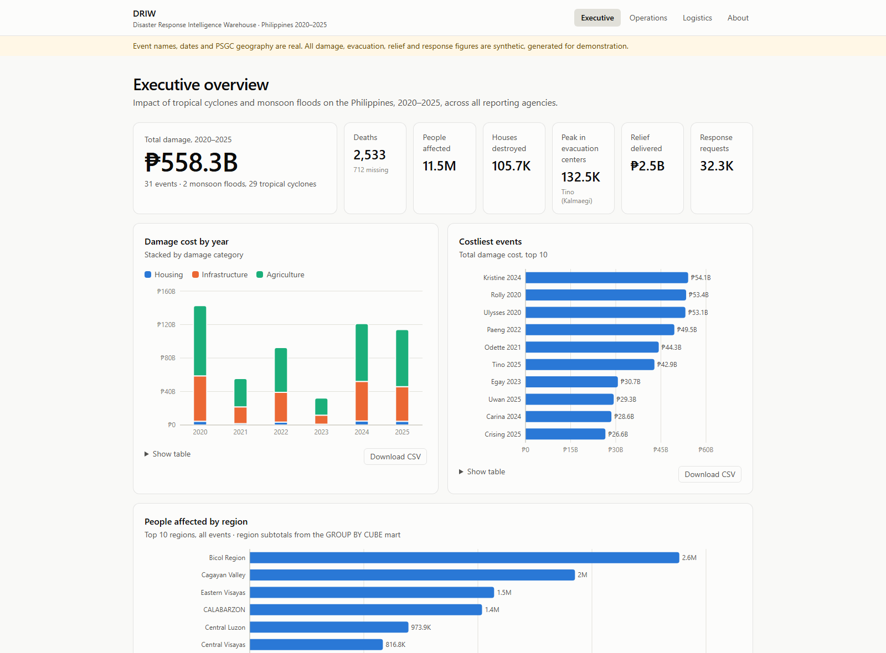
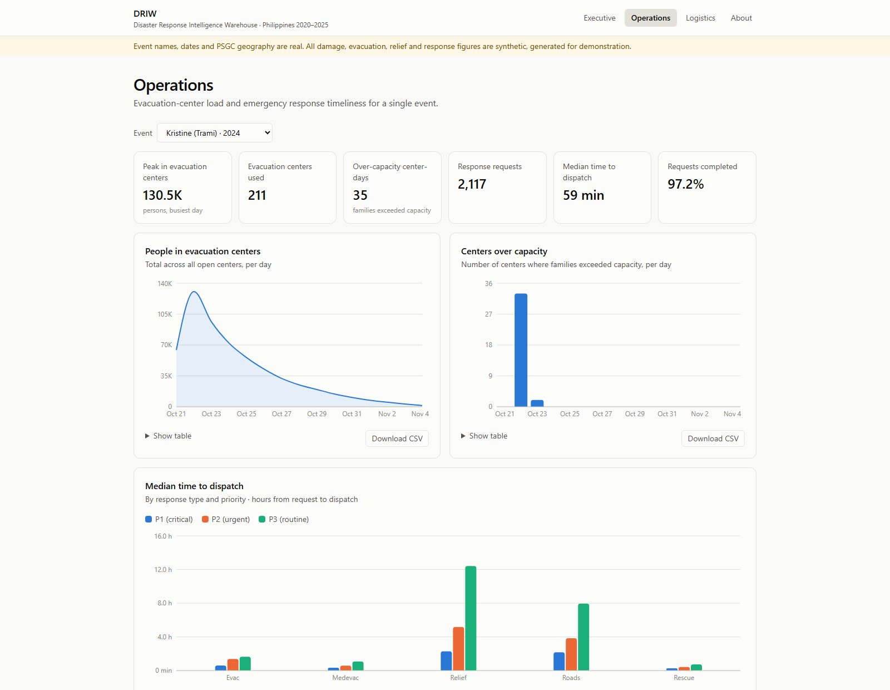
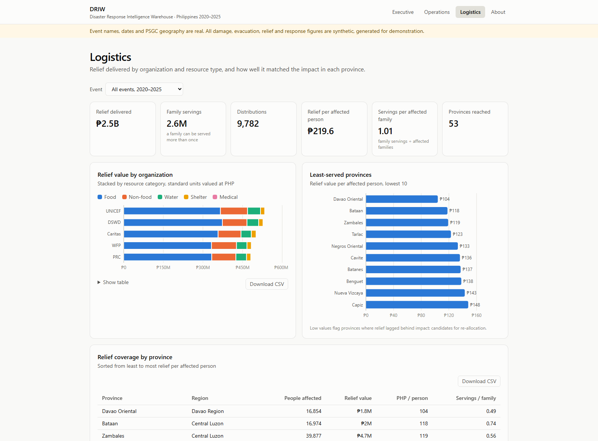

# Analytics: OLAP and Dashboards

## 1. OLAP approach (ROLAP)

DRIW implements OLAP relationally (ROLAP) in PostgreSQL rather than with a separate MOLAP cube
engine. The star schema is the cube: facts hold the measures, dimensions hold the hierarchies,
and SQL's OLAP operators produce the cube's cells.

| OLAP operation | How it is done | Example |
|---|---|---|
| Roll-up | `GROUP BY ROLLUP`, or grouping at a higher hierarchy level | Q02: damage by year with yearly subtotals |
| Drill-down | Group by a lower level of a hierarchy (region → province → city/municipality) | Q03 |
| Slice | Fix one dimension value (`WHERE`) | Q07 over-capacity centers; Q09 life-saving requests |
| Dice | Filter on several dimensions at once | Q11 organization × resource category |
| Pivot | Turn dimension values into columns (`FILTER`) | Q04 cyclone vs flood per region |
| Cube | Every combination of dimensions with subtotals (`GROUP BY CUBE`) | Q05; `mart.mart_impact_cube` |
| Grouping sets | Chosen roll-ups in one pass | `mart.mart_response_performance` |

**Pre-aggregation.** Six materialized views in the `mart` schema hold the aggregates the
dashboards need. They refresh on every build and are tested to add back up to the facts. Reading a
mart is about 78× faster than aggregating the facts (see [query-performance.md](query-performance.md)).

The full set of sample analytical queries, each tied to a business question, follows this chapter
and is in [`sample-queries.sql`](sample-queries.sql).

## 2. Dashboards

Built with Next.js and served by Apache (XAMPP) at `http://localhost/driw/`. A PHP API
(`/driw/api/marts.php`) reads the marts live from PostgreSQL as the read-only role `driw_web`; if
the warehouse is unreachable, the dashboards fall back to a bundled snapshot and say so in the footer.

Every chart has a legend, a "Show table" view with the exact numbers, and **Download CSV** of
the raw values. Colours were validated for colour-blind safety in light and dark themes.

### Executive overview (leadership)

Total damage, casualties, people affected, peak evacuees, relief delivered; damage cost by
year stacked by category; the costliest events; people affected by region (from the CUBE mart).
Answers BQ1, BQ2, BQ4.

### Operations (regional operations managers)

For one event (selectable, and shareable as a link such as
`/driw/operations/?event=TC2024-KRISTINE`): people in evacuation centers per day, centers over
capacity, and median dispatch time by response type and priority. Answers BQ5, BQ6, BQ7.

### Logistics (relief and logistics officers)

Relief by organization stacked by resource category, the least-served provinces by relief per
affected person, and the full coverage table. Answers BQ8, BQ9.

## 3. Sample findings (synthetic data)

- **Kristine (2024)** was the costliest event at about ₱54 billion; total damage across the
  31 events is ₱558.3 billion.
- **Bicol Region** had the most people affected (about 2.6 million), mainly from tropical cyclones.
- Evacuation peaks on landfall day and decays over about two weeks; overcrowding is concentrated
  in the first two days, which is when extra centers should open.
- **Relief delivery and road clearing** wait longest for dispatch, especially at routine
  priority; rescues go out fastest.
- **Davao Oriental** received the least relief per affected person (about ₱104), a candidate for
  re-allocation.

These figures come from synthetic operational data and illustrate the analysis, not real outcomes.
