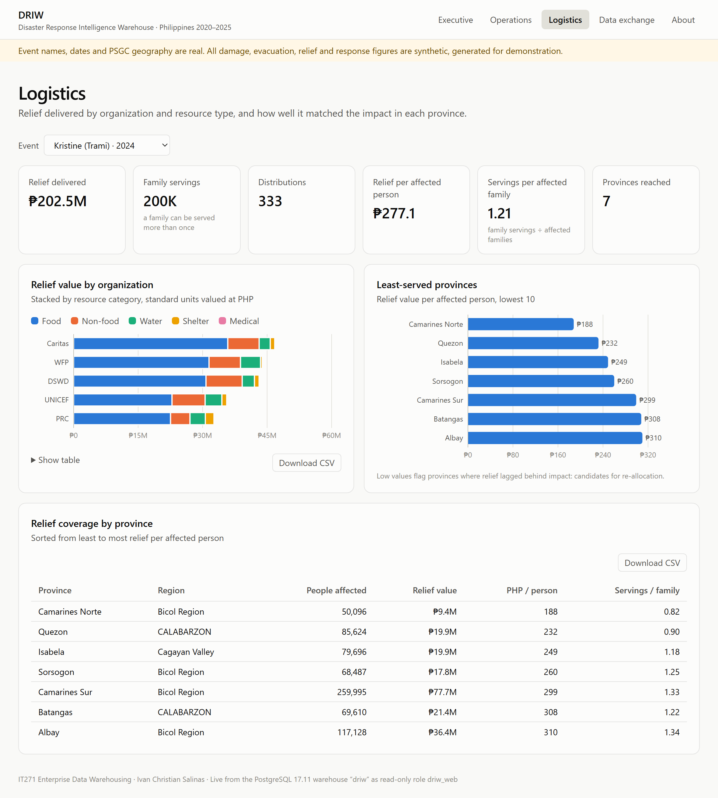
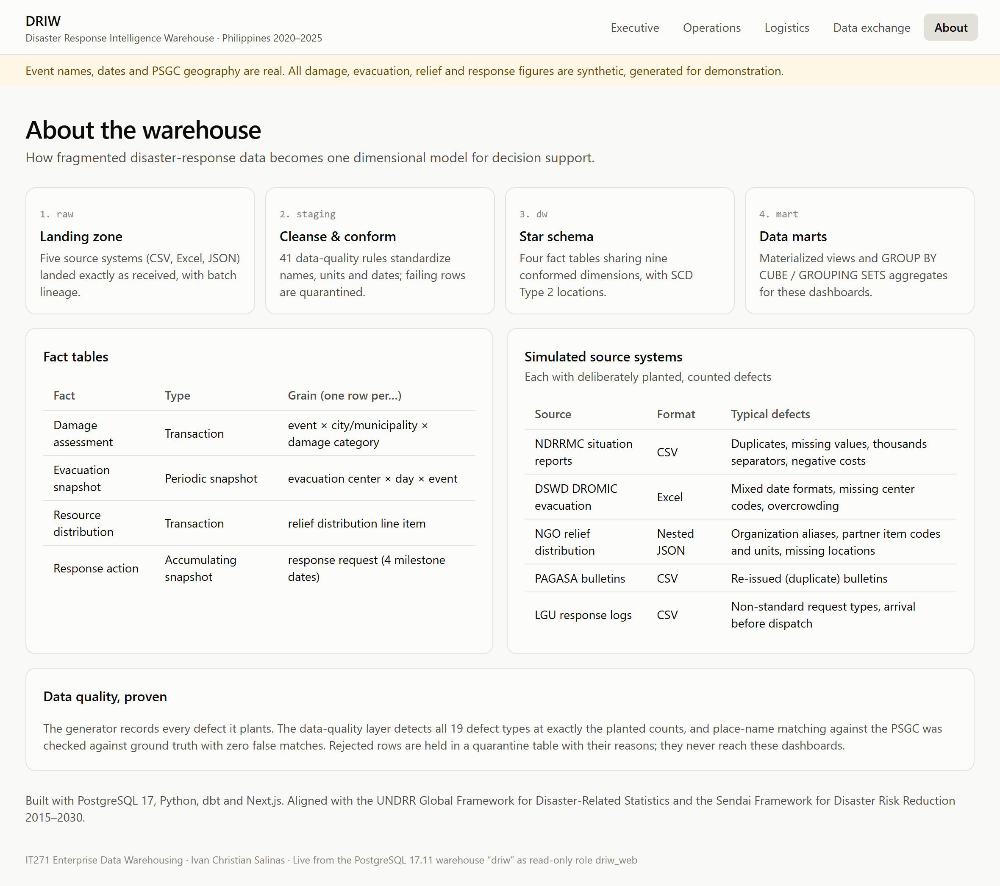
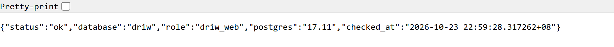
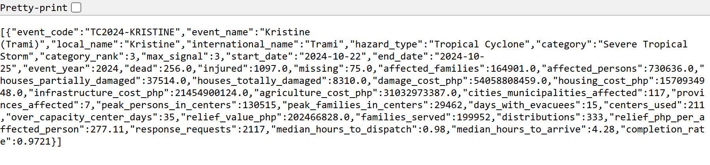
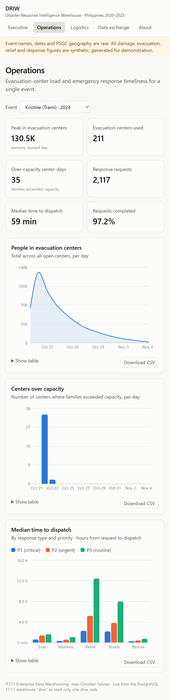

# Analytics: OLAP and Dashboards

## 1. OLAP approach (ROLAP)

DRIW implements OLAP relationally (ROLAP) in PostgreSQL rather than with a separate MOLAP cube
engine. The star schema is the cube: facts hold the measures, dimensions hold the hierarchies,
and SQL's OLAP operators produce the cube's cells.

| OLAP operation | How it is done | Example |
|---|---|---|
| Roll-up | `GROUP BY ROLLUP`, or grouping at a higher hierarchy level | Q02: damage by year with yearly subtotals |
| Drill-down | Group by a lower level of a hierarchy (region → province → city/municipality) | Q03 |
| Slice | Fix one dimension value (`WHERE`) | Q07 over-capacity centers; Q09 life-saving requests |
| Dice | Filter on several dimensions at once | Q11 organization × resource category |
| Pivot | Turn dimension values into columns (`FILTER`) | Q04 cyclone vs flood per region |
| Cube | Every combination of dimensions with subtotals (`GROUP BY CUBE`) | Q05; `mart.mart_impact_cube` |
| Grouping sets | Chosen roll-ups in one pass | `mart.mart_response_performance` |

**Pre-aggregation.** Six materialized views in the `mart` schema hold the aggregates the
dashboards need. They refresh on every build and are tested to add back up to the facts. Reading a
mart is about 78× faster than aggregating the facts (see [query-performance.md](query-performance.md)).

The full set of sample analytical queries, each tied to a business question, follows this chapter
and is in [`sample-queries.sql`](sample-queries.sql).

## 2. Dashboards and web application walkthrough

The web application is the warehouse's presentation layer. It is built with Next.js and served by
Apache (XAMPP) at `http://localhost/driw/`. A PHP API (`/driw/api/`) reads the marts live from
PostgreSQL as the read-only role `driw_web`; if the warehouse is unreachable, the pages fall back
to a bundled snapshot of the same marts. This section shows every page and explains what each
part of it means. All figures shown are synthetic (see the notice on every page).

### Elements common to every page

| Element | What it means |
|---|---|
| Navigation bar | Executive, Operations and Logistics (one per audience), Data exchange (templates, checked uploads and Excel export for LGUs and agencies, see Chapter 10) and About. |
| Yellow notice | States which data is real (event names, dates, PSGC geography) and which is synthetic (all operational figures), so no figure is mistaken for an official statistic. |
| Event selector | On Operations and Logistics. The choice is kept in the address (for example `?event=TC2024-KRISTINE`), so a view can be bookmarked, shared or reloaded. Selecting an event is an OLAP *slice*. |
| Show table | Every chart has a table with the exact numbers: the accessible, color-free way to read it. |
| Download CSV | Exports the rows behind the chart with raw, unformatted values; the file opens directly in Excel. |
| Footer | Says where the numbers came from: "Live from the PostgreSQL warehouse … as read-only role driw_web", or that the bundled snapshot is being shown. |

### Executive overview

**Audience and purpose.** Leadership (NDRRMC council, regional directors) needs the six-year picture
on one screen: how bad it was, when, and where. Answers BQ1, BQ2 and BQ4. Data comes from
`mart_event_summary` (one row per event) and `mart_impact_cube` (the `GROUP BY CUBE` mart).

| Part of the screen | What it shows and how to read it |
|---|---|
| Hero figure | **₱558.3B** total damage across **31 events** (29 tropical cyclones, 2 monsoon floods), the sum of the latest valid situation report per place and category. |
| Headline tiles | Deaths (2,533, with 712 missing), people affected (11.5M), houses destroyed (105.7K), relief delivered (₱2.5B) and response requests (32.3K) are sums over events. *Peak in evacuation centers* (132.5K, Tino 2025) is different: evacuee counts are semi-additive, so it is the highest single-day total, not a sum of days. |
| Damage cost by year | Stacked columns by damage category. 2020 was the costliest year (₱142.6B, four events) and 2023 the lightest (₱32.2B). Agriculture is the largest category every year (₱83.9B of 2020's total), then infrastructure; housing is the smallest. |
| Costliest events | The ten events ranked by damage: Kristine 2024 (₱54.1B), Rolly 2020 (₱53.4B) and Ulysses 2020 (₱53.1B) lead. Three of the top five struck in 2020. |
| People affected by region | Region subtotals read straight from the CUBE mart: Bicol Region (2.64M people, ₱145.4B), then Cagayan Valley (2.00M) and Eastern Visayas (1.50M). |
| All events table | One row per event; its CSV carries 24 measures per event for further analysis. |

**What it means for decisions.** Damage is concentrated in a few strong typhoons and in a few
regions, Bicol above all. Agriculture absorbs the largest share of losses, so preparedness spending
on crop protection and post-disaster agricultural recovery gives the most return.

### Operations (one event)

**Audience and purpose.** Regional operations managers and incident commanders. For one event,
it shows how many people were sheltered, where centers were overcrowded, and how fast teams were
dispatched. Answers BQ5, BQ6 and BQ7. Shown here for Kristine (October 2024); data comes from
`mart_event_summary`, `mart_evacuation_daily` and `mart_response_performance`.

| Part of the screen | What it shows and how to read it |
|---|---|
| Headline tiles | Peak evacuees **130.5K** on the busiest day; **211** evacuation centers used; **35** center-days over capacity; **2,117** response requests; median **59 minutes** from request to dispatch; **97.2%** of requests completed. |
| People in evacuation centers | Total evacuees across all open centers, per day. It rises from 64,326 on 21 October (pre-emptive evacuation) to the peak of 130,515 on landfall day (22 October), then decays over about two weeks as families go home. |
| Centers over capacity | Number of centers whose families exceeded capacity, per day: 33 centers on landfall day, 2 the day after, then none. Overcrowding is a one-to-two-day problem. |
| Median time to dispatch | Grouped columns by response type and priority (P1 critical, P2 urgent, P3 routine). Life-saving work goes fastest: search-and-rescue P1 in 0.26 h (about 16 minutes), medical evacuation P1 in 0.33 h. Relief delivery and road clearing wait longest, especially when routine: 12.4 h and 7.9 h at P3. |

**What it means for decisions.** Overflow centers must be ready *before* landfall, because nearly all
overcrowding happens on that one day. Priority triage works for life-saving requests; the slow
lanes are logistics (relief delivery, road clearing), where pre-positioned stock and equipment would
cut waiting most.

### Logistics (all events)

**Audience and purpose.** Relief and logistics officers of DSWD and partner NGOs. It shows who
delivered what, and whether relief reached provinces in proportion to the impact. Answers BQ8 and
BQ9. Data comes from `mart_relief_by_org_category`, `mart_province_event_impact` and
`mart_event_summary`.

| Part of the screen | What it shows and how to read it |
|---|---|
| Headline tiles | **₱2.5B** of relief in **5,529** distributions; **2.6M** family servings (a family served twice counts twice); **₱219.6** per affected person; **1.01** servings per affected family; **53** provinces reached. |
| Relief value by organization | One bar per organization, stacked by resource category in standard units valued at PHP. The five partners each delivered between ₱483M and ₱535M; food is 68–71% of every partner's value. |
| Least-served provinces | The ten provinces with the lowest relief value per affected person. Davao Oriental is lowest at about ₱104, roughly half the overall average of ₱219.6. |
| Relief coverage by province | Every province, sorted from least to most relief per person, with servings per affected family. |

**What it means for decisions.** Relief is spread evenly across partners, but not across provinces:
the bottom of the coverage ranking is where the next allocation should go first.

### Logistics filtered to one event

The same page sliced to Kristine through the event selector (`/logistics/?event=TC2024-KRISTINE`).
Every tile, chart and table re-computes for that event: ₱202.5M in 333 distributions across 7
provinces, ₱277.1 per affected person. Within one storm the gap is sharper: **Camarines Norte**
received ₱188 per person and 0.82 servings per affected family, while **Albay** received ₱310 and
1.34. A logistics officer reading this during the response would redirect the next convoys to
Camarines Norte.

### About the warehouse

A plain-language explanation of the system for any visitor, especially non-technical stakeholders:
the four layers (`raw`, `staging`, `dw`, `mart`), the four fact tables and their grain, the five
source systems with the defects each one carries, and the data-quality result (all 19 planted defect
types detected exactly; zero false place-name matches). It answers "can I trust these numbers?"
before anyone asks.

### The PHP API (back-end)

The dashboards are static pages; their data comes from two PHP endpoints. `health.php` (first image)
confirms the connection: database `driw`, PostgreSQL 17.11, connected as `driw_web`. That role is a
member of `driw_executive` only, so the web server can read the marts and nothing else (least
privilege). `marts.php` (second image) returns one mart as JSON, here `mart_event_summary` for
Kristine. Any other system can consume the same endpoint: an agency information system, or Excel and
Power BI through a web query.

### Narrow screens

The same Operations page on a narrow screen. Tiles fall into two columns and charts stack in one
column, with no sideways scrolling, so field staff can use the dashboards on a tablet or phone
during operations.

## 3. Sample findings (synthetic data)

- **Kristine (2024)** was the costliest event at about ₱54 billion; total damage across the
  31 events is ₱558.3 billion.
- **Bicol Region** had the most people affected (about 2.6 million), mainly from tropical cyclones.
- Evacuation peaks on landfall day and decays over about two weeks; overcrowding is concentrated
  in the first two days, which is when extra centers should open.
- **Relief delivery and road clearing** wait longest for dispatch, especially at routine
  priority; rescues go out fastest.
- **Davao Oriental** received the least relief per affected person (about ₱104), a candidate for
  re-allocation.

These figures come from synthetic operational data and illustrate the analysis, not real outcomes.
