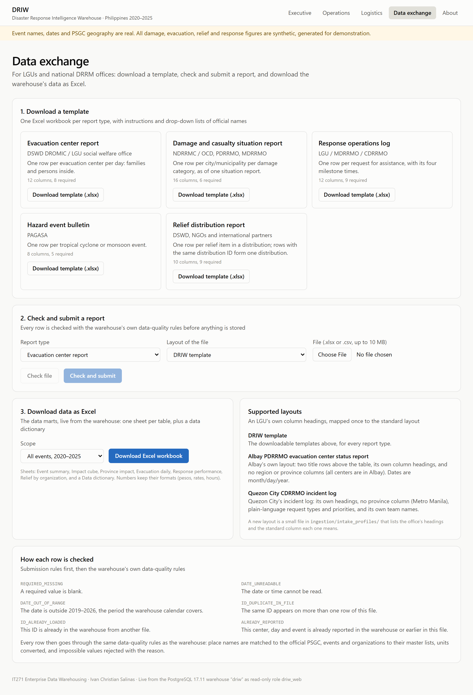
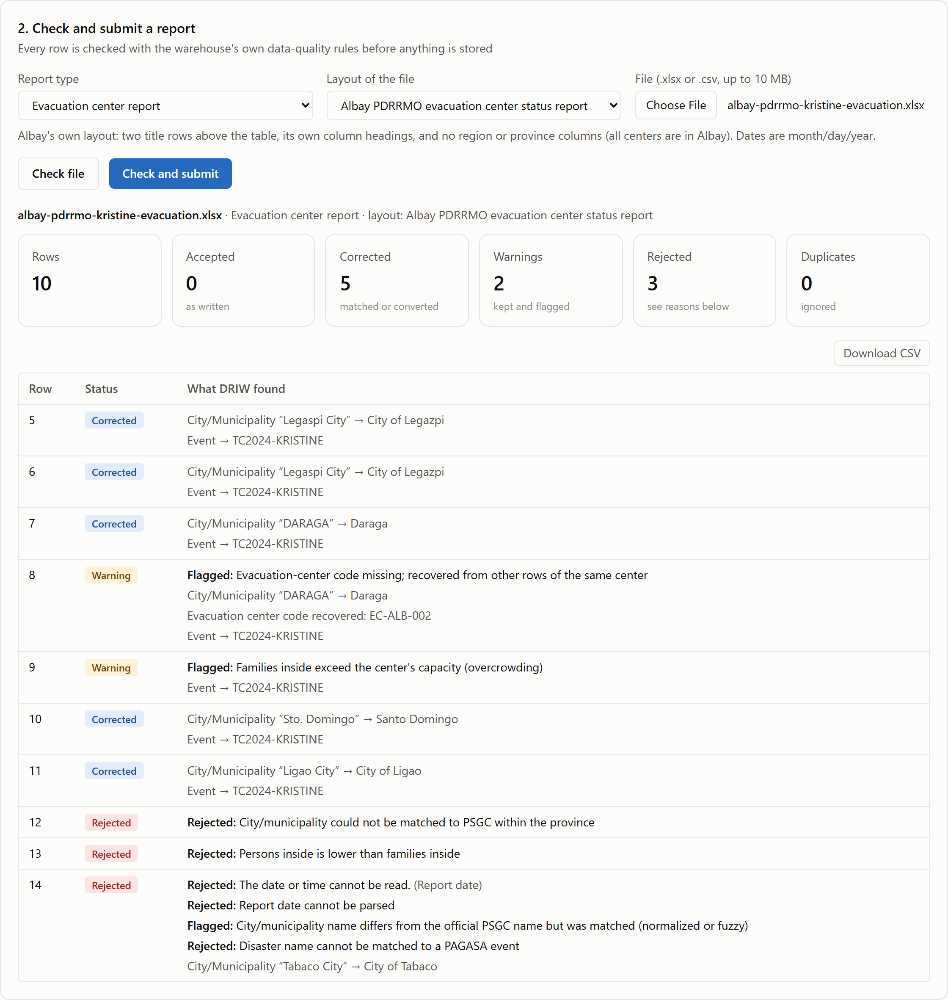

# Enterprise Positioning and Data Exchange

## 1. Why an enterprise data warehouse has no content management system

A content management system (CMS) is for creating and editing content: web pages, documents,
records typed in by users. An enterprise data warehouse (EDW) has a different job. It **receives**
data from the systems where data is entered, **integrates** it, **keeps its history**, and serves it
for analysis. The three kinds of system sit in a chain:

| Stage | Purpose | In disaster response |
|---|---|---|
| Source (operational) systems | Where data is entered and edited day to day | DROMIC workbooks, NDRRMC situation reports, LGU response logs, NGO distribution records, PAGASA bulletins |
| Enterprise data warehouse | Integrate, clean, historize and govern; read-only for its users | **DRIW** |
| Business intelligence | Present and explore | The DRIW dashboards, CSV and API exports |

DRIW deliberately has no data-entry screens. Data can enter only through the controlled ETL
pipeline, so every value is validated by the 41 data-quality rules, traceable to the file and row it
came from, and reproducible by re-running the pipeline. A screen that let users edit warehouse
figures would break all three guarantees. Where a CMS or portal belongs is upstream, as a way for an
LGU to *submit* a file, which is what the Data exchange page in §2 provides, or downstream, to
publish reports. It is never the warehouse itself.

### What makes DRIW an enterprise data warehouse

Inmon's classic definition calls a data warehouse subject-oriented, integrated, time-variant and
non-volatile. DRIW meets each one:

| Characteristic | Evidence in DRIW |
|---|---|
| Subject-oriented | Organized around four subjects of disaster response (damage, evacuation, relief, response), not around any one agency's forms. |
| Integrated | Five sources in three formats conformed to one geography (PSGC codes), one event list (PAGASA names and aliases), one set of organizations and one set of relief units. |
| Time-variant | Six years of events (2020–2025); every fact is dated; locations keep their history (SCD Type 2, e.g. the 2022 Maguindanao split). |
| Non-volatile | Users can only read; loads happen through the pipeline; a full rebuild reproduces the same warehouse (a test enforces this). |

"Enterprise" means the warehouse serves the whole organization, across agencies, from one governed
model. DRIW has the capabilities that implies:

| Enterprise capability | Where it is in DRIW |
|---|---|
| Integration of many source systems | Five simulated agency systems (Chapter 4) |
| Conformed dimensions across subjects | Bus matrix: date, location and event shared by all four facts (Chapter 2) |
| Metadata and lineage | Data dictionary generated from the catalog; every row traces to its source batch (Chapter 3) |
| Data-quality management | Rule catalog, quarantine, reconciliation 19/19 (Chapter 5) |
| Security and governance | Four roles, row-level security by region, read-only web role (Chapter 6) |
| Serving many audiences | Executive, Operations and Logistics dashboards; CSV, Excel and API exports (Chapter 7, §2 below) |
| Data exchange with LGUs and agencies | Excel templates, layout profiles, checked uploads, Excel export (§2 below) |
| Reliability | 174 automated checks (99 dbt, 75 pytest), run on every change (Chapter 8) |
| Room to grow | Standard PostgreSQL; the same migrations run on a cloud database such as Supabase |

## 2. Data exchange with LGUs and national agencies

DRIW exchanges data with LGUs and national DRRM offices in Excel. An office downloads a
template (or keeps its own layout), checks its report against the warehouse rules, submits it,
and downloads the warehouse's data back as a formatted workbook. All of it happens on one page of
the web application, **Data exchange** (`http://localhost/driw/exchange/`).

| Capability | How it works | Where |
|---|---|---|
| **Excel templates** | One workbook per report type (evacuation center report, damage and casualty sitrep, response operations log, hazard event bulletin, relief distribution report). Each has an *Instructions* sheet (every column, whether it is required, an example), a *Report* sheet with the headings, and drop-down lists of official names taken from the warehouse: provinces, cities and municipalities (PSGC), events, organizations, relief item codes and units. | `web/public/templates/`, generated by `ingestion/intake.py templates` |
| **Layout profiles** | An office whose report has its own headings, title rows, missing columns or its own codes is described once in a small file: which of its headings means which standard column, default values for columns it leaves out (e.g. province), and translations of its values (e.g. "Critical" → P1, "QC Rescue" → MDRRMO Rescue Team). Two examples ship: the Albay PDRRMO evacuation report and the Quezon City CDRRMO incident log. | `ingestion/intake_profiles/*.json` |
| **Check** | The upload is read with its layout, then checked in two stages. *Submission rules* catch problems that would break or distort a load: required values, unreadable or out-of-range dates, IDs repeated in the file or already in the warehouse, and evacuation reports already filed. Then the warehouse's **own** data-quality rules run on it: the rows are loaded into a separate sandbox database and the same dbt staging models run there, so the verdict is exactly what the warehouse would decide. Checking never changes the warehouse. | `ingestion/intake.py validate`, `web/php/api/intake.php` |
| **Per-row report** | Every row gets a status (accepted, corrected, warning, rejected, duplicate) and plain-language reasons: what was matched ("Legaspi City" → City of Legazpi), recovered, converted or translated by the layout, and why a row was rejected. The submitting office can download the report as CSV. | Data exchange page |
| **Submit** | The file is checked again, saved in the standard layout under `data/intake/`, and the warehouse is reloaded with all its tests. Valid rows reach the fact tables; rejected rows go to quarantine with their reasons. Submitting a corrected file with the same name replaces the earlier version. | `ingestion/intake.py submit` |
| **Excel export** | All six data marts as one workbook, live from the warehouse, for all events or one: an *About* sheet, one sheet per mart with styled, frozen headings, filters and number formats (pesos, percentages, hours), and a *Data dictionary* sheet describing every column. | `ingestion/export_xlsx.py`, `web/php/api/export.php` |

### Example: an LGU report in its own layout

The Albay PDRRMO keeps its evacuation report in its own workbook: two title rows, its own column
headings, no region or province columns, and dates written month/day/year. With the Albay layout
selected, DRIW reads it unchanged and returns this report:

| Row | Verdict | Why |
|---|---|---|
| 5–7, 10, 11 | Corrected | Town names written differently from the PSGC were matched: "Legaspi City" → City of Legazpi, "DARAGA" → Daraga, "Sto. Domingo" → Santo Domingo, "Ligao City" → City of Ligao. |
| 8 | Warning | The center code was blank; DRIW recovered EC-ALB-002 from the same center's other row. |
| 9 | Warning | 97 families in a center for 80: overcrowding, kept and flagged for operations. |
| 12 | Rejected | "Malniao" is equally close to two Albay towns (Malinao and Manito); DRIW does not guess. |
| 13 | Rejected | 61 persons for 64 families: the counts are likely swapped. |
| 14 | Rejected | "10/32/2024" is not a date. |

The Quezon City incident log goes through the same rules. Its plain-language request types,
priorities and team names are translated by its layout. An unknown team ("Barangay Tanod"), a team
recorded as arriving before it was dispatched, and an unclassified request are rejected, and a ticket
number used twice is not stored. Submitted in testing, its five valid requests reached the response
fact table, its three rejected rows went to quarantine, and all 99 warehouse checks still passed.

### Safeguards

- **Same rules, separate sandbox.** Checking runs the warehouse's own staging models against a
  separate database, so a file can be checked any number of times without touching the warehouse.
- **A bad file cannot break a load.** Five rules were added for problems synthetic data never had
  but real files do (unknown responding unit, dispatch before request, completion before arrival,
  unknown damage category, an event redefined with different dates), and impossible dates or
  numbers now become flagged blanks instead of database errors.
- **The synthetic-data proof stays clean.** Submitted batches are marked `origin = 'intake'`;
  the planted-defect reconciliation (19/19) and the ground-truth matching test only consider the
  synthetic extracts.
- **Submitted data stays private.** Files in `data/intake/` are excluded from Git; uploads are
  stored outside the web root and deleted after checking; the PHP endpoint passes arguments without
  a shell and accepts only `.xlsx` and `.csv` files up to 10 MB.
- **Uploads only from the server itself** until the site has sign-in (configurable), because an
  open upload form must not be reachable from the network.

## 3. Other ways in and out

| Direction | Channel | Notes |
|---|---|---|
| In | Standard files placed in `data/sources/<type>/` | The synthetic extracts, or any file already in the standard layout; loaded by `pipeline.py raw dbt` |
| Out | Download CSV on every dashboard table | Raw values; opens directly in Excel |
| Out | PHP API (`/driw/api/marts.php`) | JSON for other systems, or Excel and Power BI through a web query |
| Out | Direct SQL by role | ODBC/JDBC from Excel, Power BI or Tableau; analysts see all rows, regional officers their region |

## 4. Next steps

| Extension | What it adds |
|---|---|
| Sign-in mapped to roles | LGU officers log in, upload from anywhere, and see only their region, using the row-level security already in the database |
| Submission tracking | A dashboard of which LGUs have reported for each event, and which are late or missing |
| Scheduled, incremental loads | Load new submissions on a schedule and add only what changed, instead of a full reload per submission |
| Layout profiles from the page | Let a steward map a new office's headings on screen instead of editing a file |
| Open-data publication | Aggregated, anonymized figures in the shape of UNDRR / Sendai Framework indicators |

