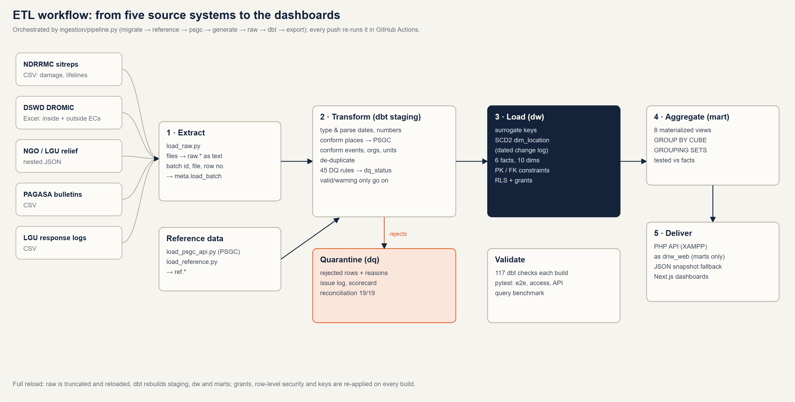

# ETL Design Document

## 1. Overview

The ETL is a set of **custom Python and SQL scripts**: Python for extraction and loading, and
**dbt** for transformation, data-quality rules and tests. One command runs the whole pipeline:

```bash
.venv/Scripts/python ingestion/pipeline.py      # migrate → reference → psgc → generate → raw → dbt → export
```



## 2. Data sources

| Source system | Format | Files | Rows landed | Typical defects (planted and counted) |
|---|---|---:|---:|---|
| NDRRMC situation reports | CSV | 31 (one per event) | 16,151 | duplicate rows, blanks and "N/A", thousands separators, negative costs, swapped figures, misspelled towns |
| NDRRMC lifeline status (roads, bridges, power, water, communications) | CSV | 31 | 2,677 | none planted; checked for unknown lifelines, unparseable times and restoration before interruption |
| DSWD DROMIC evacuation reports, sheet "Inside ECs" | Excel (.xlsx) | 31 | 31,241 | mixed date formats per field office, missing center codes, overcrowding, misspelled towns |
| DSWD DROMIC, sheet "Outside ECs" (families with relatives or friends) | same workbooks | 31 | 21,896 | none planted; same date, location and persons-vs-families checks |
| NGO, UN and LGU relief distributions | nested JSON | 6 (one per year) | 8,438 records | organization aliases, partner item codes and units, missing locations, unknown items |
| PAGASA bulletins | CSV | 1 | 39 | re-issued (duplicate) bulletins, local vs international names |
| LGU / MDRRMO response logs | CSV | 1 | 32,749 | non-standard request types, arrival before dispatch, open requests, misspelled towns |
| PSA PSGC geography | JSON (community API mirror of PSA codes) | 6 | 43,793 units | — (master data) |
| Hand-curated reference data | CSV | 3 | events, 13 organizations, 10 relief items | — |

**Mock vs real.** Event names, dates and geography are real; operational figures are synthetic,
produced by `ingestion/generate_sources.py` with seed 271 (deterministic). The generator records
each defect it plants in `_defect_manifest.json` so the transformation can be proven against it.

## 3. Extract (raw layer)

- `load_raw.py` reads each file in its native format (csv module, openpyxl, json) and bulk-loads
  it with PostgreSQL `COPY` into `raw.<source>`.
- **Every business column is stored as text**, so values like `"1,234"`, `"N/A"` or
  `"23-Oct-2024"` are never rejected at load: nothing is lost before the quality rules run.
- Each file becomes a batch in `meta.load_batch`; each row keeps `_batch_id`, `_source_file`
  and `_row_number` (lineage).
- Strategy: **full reload** (truncate and reload), appropriate for a batch analytical warehouse
  of this size and simplest to make repeatable.

## 4. Transform (staging and data-quality layers, dbt)

**Cleaning**

- Parse numbers (strip thousands separators; `"N/A"`, `"-"`, `"TBD"` → null), dates in four
  formats (ISO, US, `DD-Mon-YYYY`, Excel serial numbers) and timestamps.
- Trim and normalize text; map non-standard codes (`RESQ` → `RESCUE`, `Medical` → `MEDEVAC`).
- Remove exact duplicates (sitrep rows, re-issued bulletins).
- Impute a missing evacuation-center code when the same place, name and barangay always carry one code.

**Integration (conformance)**

- **Places → PSGC** (`stg_location_resolution`): exact name, then normalized name, then fuzzy
  match (Levenshtein ≤ 2) within the reported province; ties are left for a steward.
  0 false matches against ground truth across 63,347 rows.
- **Events**: local name, international name, `TY <NAME>` or code, matched within the event's
  time window (PAGASA reuses names).
- **Organizations and relief items**: alias tables in `ref`; partner quantities converted to a
  standard unit (e.g. 1 sack of rice = 50 kg).
- NGO JSON is flattened from one record per distribution to one row per item line.

**Data-quality rules.** 45 rules in `dq_rules` with severity *info* (corrected), *warning*
(kept, flagged) or *reject* (quarantined). Every staging row gets `dq_issues` and `dq_status`;
staging never drops a row. Details: [data-quality-framework.md](data-quality-framework.md).

**Aggregation.** Facts keep detail at their grain; aggregation happens in the marts
(materialized views) with `GROUP BY CUBE` and `GROUPING SETS`, and in dashboard queries.

## 5. Load (warehouse and marts)

- **Dimensions** load first: surrogate keys by `row_number()`; `dim_location` built as
  **SCD Type 2** from `ref.psgc` plus a dated change log (`psgc_changes`).
- **Facts** load only *valid* and *warning* rows and look up each dimension key; locations are
  looked up **as of the fact's date** (SCD2). Damage keeps the latest valid sitrep per
  event × place × category (sitreps are cumulative).
- Open milestones (a request not yet completed) point to date key -1, so foreign keys are never null.
- After each model: primary/foreign keys, grants and row-level-security policies are re-applied (post-hooks).
- **Marts** refresh as materialized views; `export_marts.py` writes the dashboards' fallback snapshot.

## 6. Orchestration, scheduling and error handling

| Concern | Design |
|---|---|
| Orchestration | `ingestion/pipeline.py` runs the steps in order; any step can be run alone (`pipeline.py dbt export`). |
| Scheduling | Batch, on demand or by a scheduler (Windows Task Scheduler / cron) running `pipeline.py`; GitHub Actions runs the full pipeline on every push. |
| Idempotency | Full reload plus dbt's rebuild make every run produce the same warehouse from the same inputs (tested). |
| Row-level errors | Never stop the load: bad rows go to `dq.dq_quarantine` with their reasons and source file and row. |
| Step failures | `pipeline.py` stops at the first failing step; `dbt build` fails if any of its 99 tests fail, so a bad build is never published. |
| Monitoring | `dq.dq_rule_summary` (scorecard), `dq.dq_reconciliation`, `meta.load_batch` (row counts and times per file). |

## 7. Tools

| Purpose | Tool |
|---|---|
| Extraction and loading | Python 3.13, psycopg 3 (`COPY`), openpyxl |
| Transformation, data quality, tests | dbt Core 1.12 with dbt-postgres |
| Warehouse | PostgreSQL 17 |
| Orchestration and CI | `pipeline.py`, GitHub Actions |
| Delivery | PHP 8.1 API on XAMPP (Apache), Next.js dashboards |
