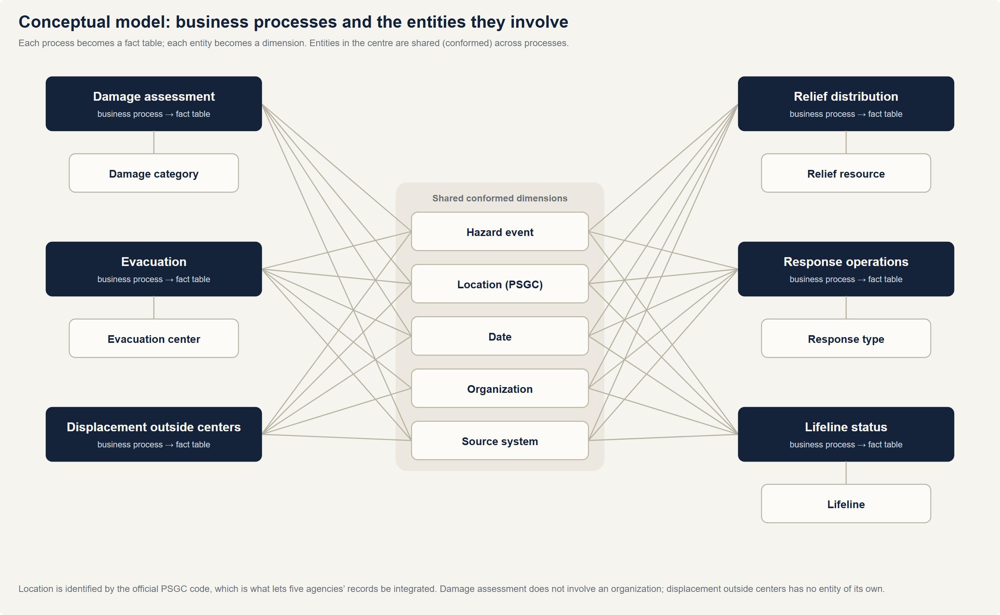
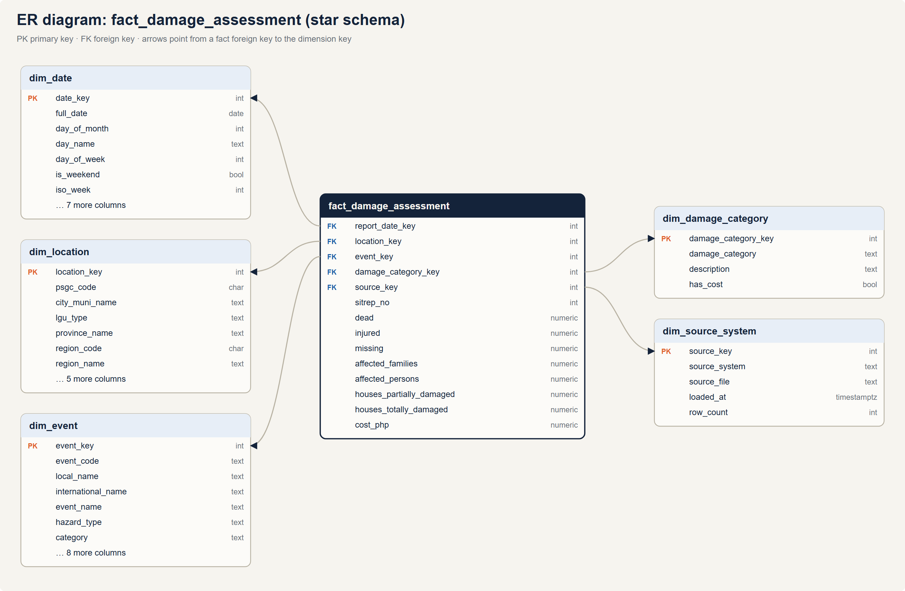
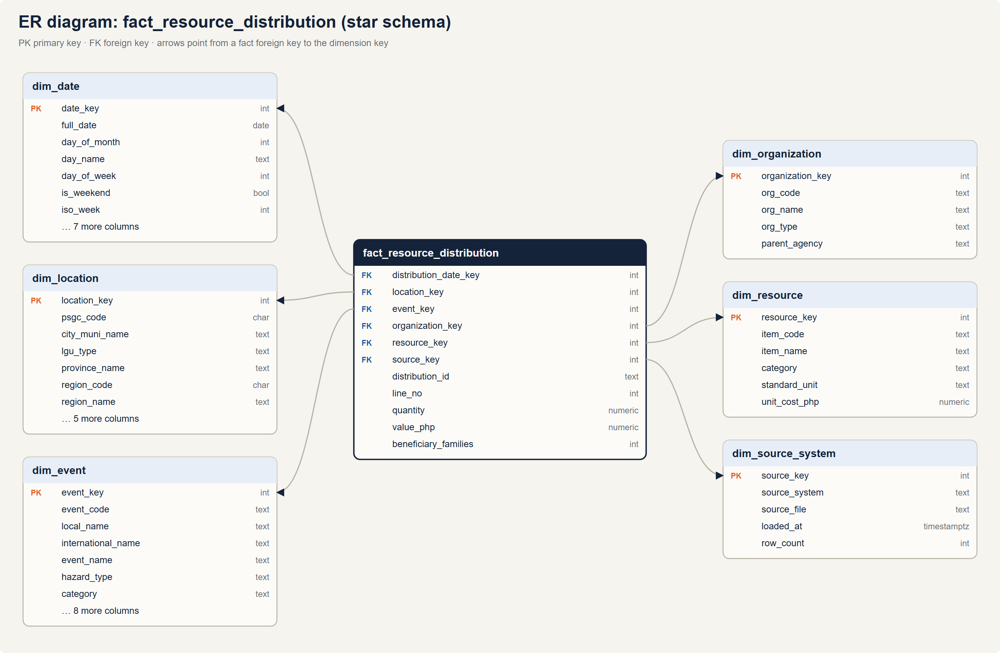
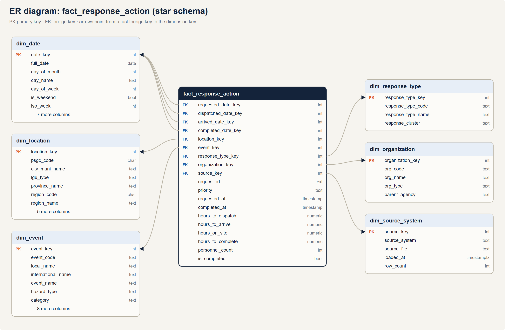
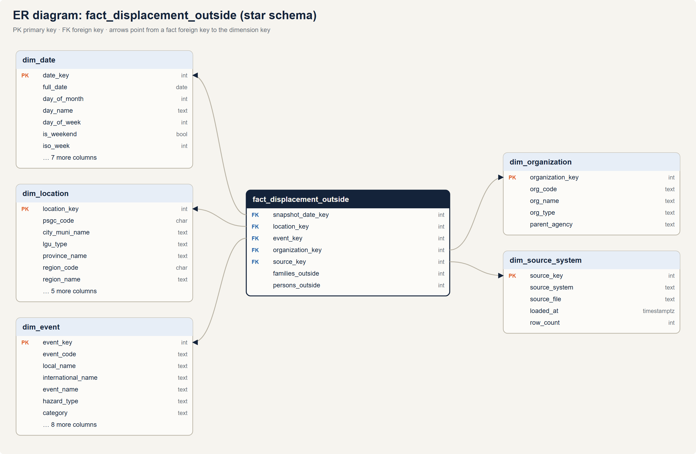
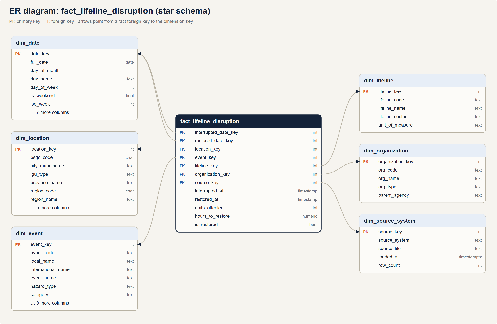

# Data Warehouse Design: Conceptual, Logical and Physical Models

The design moves from business concepts to tables in three levels. The logical level is
detailed in [dimensional-model.md](dimensional-model.md) (grains, bus matrix, SCD Type 2,
design decisions); the full column list is in [data-dictionary.md](data-dictionary.md).

## 1. Conceptual model

The DRIW answers questions about four **business processes**, each recorded by a different
agency. Every process involves the same core **entities**: a hazard event, a place, a date, the
organizations involved and the source that reported it. These shared entities are what allow the
processes to be analyzed together.

| Business process | Reported by | Key question it answers | Entities involved |
|---|---|---|---|
| Damage assessment | NDRRMC | How bad was it, and where? | Event, Location, Date, Damage category, Source |
| Evacuation | DSWD DROMIC | How many were displaced, and were centers adequate? | Event, Location, Date, Organization, Evacuation center, Source |
| Relief distribution | NGOs, UN agencies, DSWD | Did relief reach the people affected? | Event, Location, Date, Organization, Relief resource, Source |
| Response operations | LGUs / MDRRMOs | How fast did help arrive? | Event, Location, Date, Organization, Response type, Source |

**Why a dimensional (Kimball) design.** The users ask aggregate, multi-perspective questions
("damage by region by year by hazard"), not transactional ones. A dimensional model makes those
questions simple to write and fast to run, and conformed dimensions let the four processes be
compared directly. The enterprise integration happens in the staging layer before data reaches
the stars.

## 2. Logical model

Each business process becomes a **fact table** at a stated grain; each entity becomes a
**dimension**. The model is a set of six **star schemas** sharing conformed dimensions
(a "constellation").

| Fact table | Type | Grain (one row per…) | Measures |
|---|---|---|---|
| `fact_damage_assessment` | Transaction | event × city/municipality × damage category | dead, injured, missing, affected families/persons, houses damaged, cost (PHP) |
| `fact_evacuation_snapshot` | Periodic snapshot | evacuation center × day × event | families inside, persons inside, capacity, over-capacity flag |
| `fact_resource_distribution` | Transaction | relief item in one distribution | quantity (standard unit), value (PHP), beneficiary families |
| `fact_response_action` | Accumulating snapshot | response request | hours to dispatch / arrive / on site / complete, personnel, completed flag |
| `fact_displacement_outside` | Periodic snapshot | city/municipality × day × event | families and persons displaced outside evacuation centers |
| `fact_lifeline_disruption` | Accumulating snapshot | event × city/municipality × lifeline | units affected, hours to restore, restored flag |

| Dimension | Natural key | History | Hierarchy / notable attributes |
|---|---|---|---|
| `dim_date` | calendar date | Type 0 | year → quarter → month → day; typhoon season; -1 "Not yet occurred" |
| `dim_location` | PSGC code | **Type 2** | region → province → city/municipality; population (Type 1, denominator for per-100,000 rates) |
| `dim_event` | event code | Type 1 | hazard type → category → event |
| `dim_organization` | org code | Type 1 | org type → organization |
| `dim_resource` | item code | Type 1 | category → item |
| `dim_evacuation_center` | EC code | Type 1 | type, barangay, capacity |
| `dim_damage_category` | category | Type 0 | — |
| `dim_response_type` | type code | Type 0 | cluster → type |
| `dim_lifeline` | lifeline code | Type 0 | sector (transport, utilities) → lifeline; unit of measure |
| `dim_source_system` | batch id | — | lineage: source system → file |

**Star, not snowflake.** Dimensions are kept denormalized (region and province names sit in
`dim_location` rather than in separate region and province tables). This costs a little storage
but keeps every query to one join per dimension, which suits the BI users, and the hierarchies
are small. The PSGC master data itself stays normalized in `ref.psgc`, so the star is derived
from a single authoritative source.

The bus matrix, measure additivity rules and the SCD Type 2 treatment of the 2022 Maguindanao
split are in [dimensional-model.md](dimensional-model.md).

## 3. Physical model

**Platform.** PostgreSQL 17 (local; the same migrations run unchanged on Supabase). Database
size about 80 MB.

**Schemas as layers.**

| Schema | Contents | Built by | Materialization |
|---|---|---|---|
| `raw` | source data as received (text) | Python | tables, truncated and reloaded |
| `ref`, `meta` | master data, lineage, defect manifest | Python, dbt seeds | tables |
| `staging` | typed, conformed, quality-tagged data | dbt | tables |
| `dq` | rules, issue log, scorecard, quarantine, reconciliation | dbt | tables |
| `dw` | dimensions and facts | dbt | tables with PK/FK constraints and row-level security |
| `mart` | dashboard aggregates, CUBE, GROUPING SETS | dbt | materialized views |
| `secure`, `governance` | region-scoped views, role mapping | dbt, migration | views |

**Keys and data types.**

- Surrogate keys are `integer`s generated in dbt (`row_number()` over the natural key), so
  facts join on small integers. `dim_date` uses a smart key, `YYYYMMDD`.
- Natural keys are kept as attributes (`psgc_code`, `event_code`, `ec_code`, `org_code`,
  `item_code`) for traceability.
- Every dimension has a **primary key**; every fact has **foreign keys** to its dimensions
  (38 in total), declared as real constraints so ERD tools draw the schema and the database
  enforces referential integrity.
- Measures use `numeric` (exact money and counts) or `integer`; elapsed times are `numeric(…, 2)`
  hours; flags are `boolean`.
- Degenerate dimensions stay on the fact (`sitrep_no`, `distribution_id` + `line_no`,
  `request_id`, `priority`).

**Performance.** Dashboards read the marts (materialized views), not the facts: about 78× faster
for the event summary. At the current volume every analytical query runs in well under 50 ms
with sequential scans (see [query-performance.md](query-performance.md)). The scale-up path is
B-tree indexes on the most-filtered fact foreign keys and partitioning facts by event year.

**Security objects.** Row-level security policies on all six facts, grants declared in dbt
(re-applied on every build), and the `governance.my_regions` view (see [governance.md](governance.md)).

### ER diagrams

Generated from the database catalog by `docs/build/diagrams.py`, so they always match the
deployed schema.

